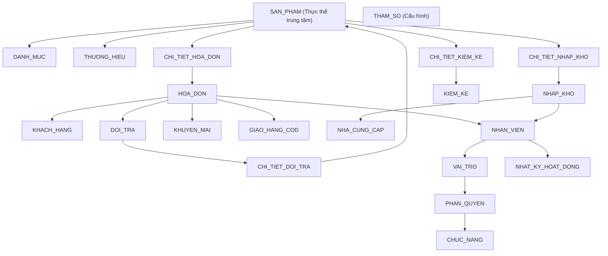

# BÁO CÁO THỰC HÀNH CÔNG NGHỆ PHẦN MỀM
## BÀI LAB 3: THIẾT KẾ CƠ SỞ DỮ LIỆU QUAN HỆ
**Trường**: Đại học Sư phạm Thành phố Hồ Chí Minh (HCMUE)  
**Khoa**: Công nghệ Thông tin  
**Học phần**: Nhập môn Công nghệ Phần mềm  
**Đề tài**: Phần mềm Quản lý Bán hàng Dụng cụ Thể thao (Công ty ENERGY)  
**Nhóm thực hiện**: ENERGY (Hoàng Nam Thanh Tiến Quốc Vượng, Đỗ Chí An, Nguyễn Thái Dương, Phạm Thành Thuật)

---

## I. TỔNG QUAN VÀ NGUYÊN LÝ THIẾT KẾ (VẾT DẦU LOANG)

Cơ sở dữ liệu được xây dựng xuất phát từ bài toán thực tế của Công ty ENERGY theo nguyên lý **vết dầu loang**:

1. **Từ thực thể trung tâm `SAN_PHAM`**:
   - Mở rộng phân loại qua `DANH_MUC` (Vợt cầu lông, Giày thể thao, Quần áo...) và `THUONG_HIEU` (Yonex, Victor, Nike, Adidas, Wilson...).
   - Hỗ trợ lưu trữ riêng biệt `GiaBanLe` ($SL < 10$) và `GiaBanSi` ($SL \ge 10$) để đáp ứng quy định **QD01**.

2. **Nghiệp vụ Bán hàng & Hóa đơn**:
   - `KHACH_HANG` giao dịch với `NHAN_VIEN` sinh ra `HOA_DON`.
   - Mỗi hóa đơn bao gồm nhiều `CHI_TIET_HOA_DON` liên kết tới `SAN_PHAM`.
   - Mở rộng bảng `GIAO_HANG_COD` cho các đơn hàng giao online có thu hộ COD.
   - Bảng `KHUYEN_MAI` lưu trữ mã voucher giảm giá.

3. **Nghiệp vụ Nhập kho & Nhà cung cấp**:
   - `NHA_CUNG_CAP` cung cấp hàng hóa qua phiếu `NHAP_KHO` và `CHI_TIET_NHAP_KHO`.
   - Tích hợp trường `TrangThaiDuyet` để hỗ trợ quy định **QD05** (Phiếu nhập $> 20.000.000$ VNĐ phải trình Giám đốc duyệt mới được tăng tồn kho).

4. **Nghiệp vụ Đổi trả & Kiểm kê**:
   - `DOI_TRA` và `CHI_TIET_DOI_TRA`: Xử lý trả hàng trong vòng 7 ngày, hoàn kho và trừ điểm tích lũy theo **QD02**.
   - `KIEM_KE` và `CHI_TIET_KIEM_KE`: Ghi nhận chênh lệch kiểm kê thực tế và hệ thống, cảnh báo duyệt khi lệch $> 2\%$ theo **QD03**.

5. **Tính Tiến hóa & Cấp Hệ thống**:
   - `THAM_SO`: Tránh hard-code các giá trị nghiệp vụ (Tên cửa hàng, hotline, hạn mức duyệt nhập 20.000.000 VNĐ, tỷ lệ tích điểm 1%, hạn đổi trả 7 ngày).
   - `VAI_TRO`, `CHUC_NANG`, `PHAN_QUYEN`: Mô hình phân quyền theo vai trò (RBAC).
   - `NHAT_KY_HOAT_DONG`: Audit log phục vụ an toàn và điều tra sự cố.

---

## II. TỪ ĐIỂN DỮ LIỆU ĐẦY ĐỦ (DATA DICTIONARY)

Chi tiết cấu trúc 17 bảng được chuẩn hóa dạng 3NF:

1. **DANH_MUC**: `MaDanhMuc` (PK, INT IDENTITY), `TenDanhMuc` (NVARCHAR(100)).
2. **THUONG_HIEU**: `MaThuongHieu` (PK, INT IDENTITY), `TenThuongHieu` (NVARCHAR(100)).
3. **SAN_PHAM**: `MaSanPham` (PK, INT IDENTITY), `TenSanPham` (NVARCHAR(200)), `MaDanhMuc` (FK), `MaThuongHieu` (FK), `GiaNhap` (DECIMAL(18,2)), `GiaBanLe` (DECIMAL(18,2)), `GiaBanSi` (DECIMAL(18,2)), `SoLuongTon` (INT), `DonViTinh` (NVARCHAR(50)).
4. **KHACH_HANG**: `MaKhachHang` (PK, INT IDENTITY), `HoTen` (NVARCHAR(100)), `SoDienThoai` (VARCHAR(15) UNIQUE), `Email` (VARCHAR(100)), `DiaChi` (NVARCHAR(255)), `DiemTichLuy` (INT).
5. **VAI_TRO**: `MaVaiTro` (PK, INT IDENTITY), `TenVaiTro` (NVARCHAR(50)).
6. **NHAN_VIEN**: `MaNhanVien` (PK, INT IDENTITY), `HoTen` (NVARCHAR(100)), `SoDienThoai` (VARCHAR(15)), `MaVaiTro` (FK), `TenDangNhap` (VARCHAR(50) UNIQUE), `MatKhau` (VARCHAR(255)), `TrangThai` (BIT).
7. **CHUC_NANG**: `MaChucNang` (PK, VARCHAR(50)), `TenChucNang` (NVARCHAR(150)).
8. **PHAN_QUYEN**: `MaVaiTro` (PK, FK), `MaChucNang` (PK, FK).
9. **NHAT_KY_HOAT_DONG**: `MaNhatKy` (PK, INT IDENTITY), `MaNhanVien` (FK), `HanhDong` (NVARCHAR(255)), `ThoiGian` (DATETIME), `ChiTiet` (NVARCHAR(MAX)).
10. **KHUYEN_MAI**: `MaKhuyenMai` (PK, INT IDENTITY), `MaCode` (VARCHAR(20) UNIQUE), `TenKhuyenMai` (NVARCHAR(100)), `PhanTramGiam` (INT), `NgayBatDau` (DATETIME), `NgayKetThuc` (DATETIME).
11. **HOA_DON**: `MaHoaDon` (PK, INT IDENTITY), `NgayLap` (DATETIME), `MaKhachHang` (FK), `MaNhanVien` (FK), `MaKhuyenMai` (FK), `TongTienHang` (DECIMAL(18,2)), `SoTienGiam` (DECIMAL(18,2)), `TongTien` (DECIMAL(18,2)), `TienKhachDua` (DECIMAL(18,2)), `TienThoiLai` (DECIMAL(18,2)), `DiemCongThem` (INT), `HinhThucThanhToan` (NVARCHAR(50)).
12. **CHI_TIET_HOA_DON**: `MaHoaDon` (PK, FK), `MaSanPham` (PK, FK), `SoLuong` (INT), `DonGia` (DECIMAL(18,2)), `LoaiGia` (NVARCHAR(20)).
13. **GIAO_HANG_COD**: `MaGiaoHang` (PK, INT IDENTITY), `MaHoaDon` (FK), `DonViVanChuyen` (NVARCHAR(100)), `MaTracking` (VARCHAR(50)), `DiaChiGiao` (NVARCHAR(255)), `TienThuHo` (DECIMAL(18,2)), `TrangThai` (NVARCHAR(50)), `NgayDoiSoat` (DATETIME).
14. **THAM_SO**: `MaThamSo` (PK, VARCHAR(50)), `GiaTri` (NVARCHAR(255)), `MoTa` (NVARCHAR(255)).
15. **NHA_CUNG_CAP**: `MaNCC` (PK, INT IDENTITY), `TenNCC` (NVARCHAR(150)), `SoDienThoai` (VARCHAR(15)), `DiaChi` (NVARCHAR(255)).
16. **NHAP_KHO**: `MaPhieuNhap` (PK, INT IDENTITY), `NgayNhap` (DATETIME), `MaNCC` (FK), `MaNhanVien` (FK), `TongTienNhap` (DECIMAL(18,2)), `TrangThaiDuyet` (NVARCHAR(50)).
17. **CHI_TIET_NHAP_KHO**: `MaPhieuNhap` (PK, FK), `MaSanPham` (PK, FK), `SoLuongNhap` (INT), `GiaNhap` (DECIMAL(18,2)).

---

## III. FILE SCRIPT CƠ SỞ DỮ LIỆU
File T-SQL DDL & DML hoàn chỉnh được đặt tại: [`database/database.sql`](file:///c:/Users/MY%20PC/Downloads/quanlibanhang/database/database.sql).
Hỗ trợ thực thi trên SQL Server Management Studio (SSMS) từ SQL Server 2008 R2, 2012, 2019 đến 2022.

